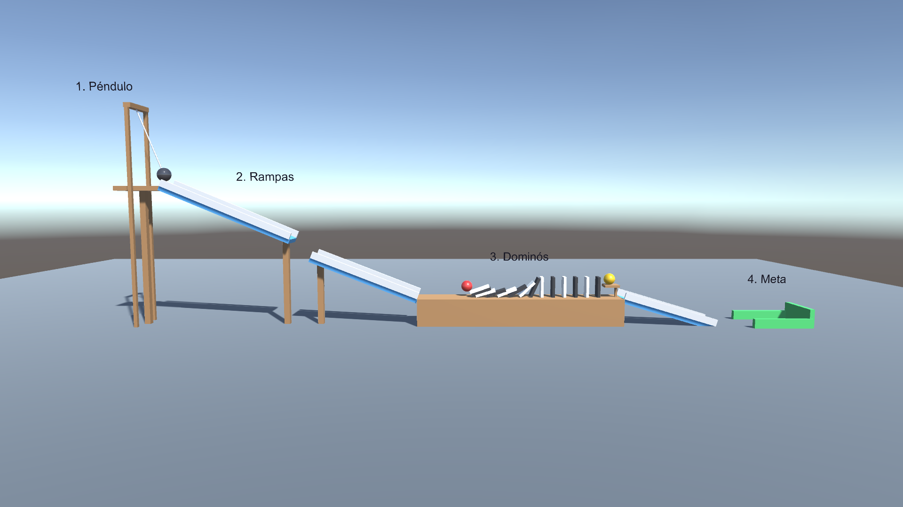

# Máquina de Rube Goldberg — Primer Taller Unity

Proyecto de Unity 6 (6000.6.6f1) que usa el motor de físicas (PhysX) para encadenar varias reacciones hasta llegar a una meta.

## Etapas de la máquina

1. **Péndulo**: una esfera pesada unida con un `HingeJoint` se suelta a 60° y golpea la bola roja.
2. **Rampas**: la bola roja baja por una rampa, salta un hueco y cae en una segunda rampa.
3. **Dominós**: la bola choca con una fila de 14 fichas (`Rigidbody` + `PhysicsMaterial` con alta fricción) que caen en cadena.
4. **Meta**: la última ficha empuja la bola amarilla desde una repisa; baja por la tercera rampa hasta la zona de meta, un `BoxCollider` con `isTrigger` que lanza confeti (`ParticleSystem`) y enciende una luz.

## Conceptos de física usados

- `Rigidbody` (masa, interpolación, detección de colisión continua)
- Colliders primitivos (`BoxCollider`, `SphereCollider`) y triggers (`OnTriggerEnter`)
- `HingeJoint` para el péndulo
- `PhysicsMaterial` para ajustar fricción y rebote
- Gravedad y conservación de energía en las rampas

## Cómo abrirlo

1. En Unity Hub: **Add → Add project from disk** y elegir esta carpeta.
2. Abrir la escena `Assets/Scenes/RubeGoldberg.unity`.
3. Pulsar **Play**: el péndulo se suelta solo a los 1,5 s. Con **R** o el botón *Reiniciar* se repite.

## Scripts

| Script | Función |
|---|---|
| `Assets/Scripts/MachineStarter.cs` | Suelta el péndulo después de un retraso |
| `Assets/Scripts/GoalTrigger.cs` | Detecta la bola en la meta y lanza el confeti |
| `Assets/Scripts/MachineHUD.cs` | Muestra título, cronómetro, estado y botón de reinicio |
| `Assets/Editor/RubeGoldbergBuilder.cs` | Menú **Rube Goldberg**: reconstruye la escena y simula la física para comprobar que la cadena llega a la meta |
